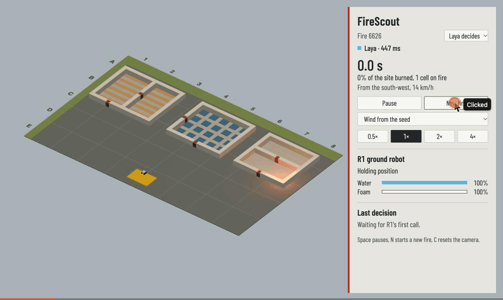
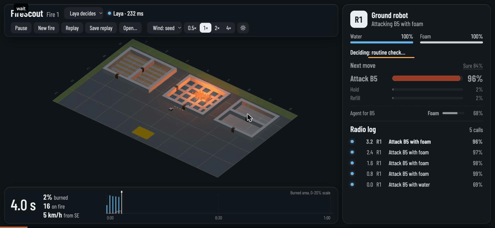

# FireScout

A recon drone and a tracked firefighting robot put out a fire in a simulated industrial yard.
Neither is driven by a language model: **a decision model decides, a deterministic controller executes.**

> Work in progress.

## Layout

| Path | What |
|---|---|
| `sim/` | Pure TypeScript simulation (seeded, no DOM): grid, fire, smoke, units, controllers |
| `web/` | Vite + three.js scene and HUD |
| `bench/` | Headless runner: N seeds × policy → logs and charts |
| `brain-client/` | WebSocket protocol (zod) and the `RemotePolicy` used by `web` and `bench` |
| `brain/` | Python decision server (FastAPI + WebSocket) running Laya-MLX locally |
| `shared/` | JSON fixtures that pin the protocol and the model's prompts on both sides |
| `docs/` | Notes and results |

## Requirements

macOS on Apple silicon (for MLX), Node 22+, pnpm 10, [uv](https://docs.astral.sh/uv/).

## Commands

```sh
pnpm install
pnpm dev         # web demo
pnpm test        # TypeScript tests
pnpm typecheck
pnpm lint
pnpm bench

cd brain
uv sync
uv run pytest
```

## Play with Laya

The robot's decisions come from Laya-MLX, running locally in `brain/`. Start the brain, then the web demo:

```sh
cd brain && uv run firescout-brain       # loads Laya (~15 s), listens on ws://127.0.0.1:8765/ws
pnpm dev                                 # in another terminal, then open http://localhost:5173
```

The panel says who decided R1's last move: `Laya · 300 ms`, or `Brain offline, baseline rules` when the brain is
not running (the game keeps going on the hand-written rules and switches back when the brain returns). The select
next to the fire name switches between Laya and the rules on the same seed. `uv run firescout-brain --backend mock`
starts a model-free brain for testing; `VITE_BRAIN_URL` points the web demo at another address. Every decision is
appended to `brain/logs/decisions.jsonl`.

`pnpm --filter @firescout/bench e2e --seed 1` plays one seed twice against the running brain and checks that both
games end in the same state, whatever the model's latency.



## Follow and replay a game

- **Decision card** (right): R1's current task and tanks, then its last call. Every option of the main question
  gets a bar, and the one R1 acts on is red. `Sure 62%` is Laya's confidence: 0% is an even guess across the
  options, 100% is certain. Below it, the extinguishing agent Laya picked for each fire it could attack.
- **Radio log**: the latest calls, newest first. Click one to open its details.
- **Timeline** (bottom): one stem per decision at its sim time, as tall as Laya was sure. Blue means Laya
  answered, red means the rules stood in while the brain was away, and a diamond marks a door call. The shaded
  curve is the burned area. Hover a stem to read it; click it to open the details.
- **Details drawer**: the state text exactly as the model read it, then every question with every option's
  description and probability, `Sure` and `Top answer` (the chosen option's calibrated probability).
  ←/→ walk through the decisions; Esc closes it.
- **Replay** (`R`): plays the current game again from the start, using only the seed and the recorded answers.
  Play/Pause, step to the previous or next decision, or click the timeline (or drag the playhead) to seek.
  **Back to live** (`R` or Esc) returns to the paused game where it was.
- **Save replay** downloads the game as `firescout-fire-<seed>-<policy>.json`; **Open…** plays a saved file. A
  file that the current simulation can't reproduce, for example one recorded before a balance change, isn't
  opened: the panel names the first decision where it diverges and stays in the live game.


